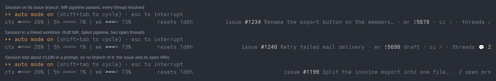

# issue-line changelog

## 0.1.0 — 2026-11-19

First release. At the right end of the hint line under the prompt: `issue #1234 <title…> · mr !5678 · ci ✓ ·
threads ✓`, in usage-percent's look (dim labels, colour only for a state). Number, title and MR are links.
Each session finds its own issue: a `/issue-line` pin, else the first issue or MR its prompts name (`#1234`,
`!1234`, a GitLab link, `issue 1234`), else the branch of the folder its shell commands work in (`cd <dir>`,
`git -C <dir>`), so parallel sessions in linked worktrees each show theirs. A resumed session reads both from
its transcript. Of an issue's MRs it takes the one on that branch, else the only open one. The MR number is left
out when Claude Code's hint line already shows it. One `glab api graphql` call per refresh.

